# AI Data Intelligence Platform

An end-to-end, local-first platform to **upload datasets, clean them, explore them, visualise them, train and track
machine-learning models, chat with the data using Google Gemini, and export professional PDF reports.**
Built with FastAPI, PostgreSQL, scikit-learn, React + TypeScript and the official Google Gemini SDK.

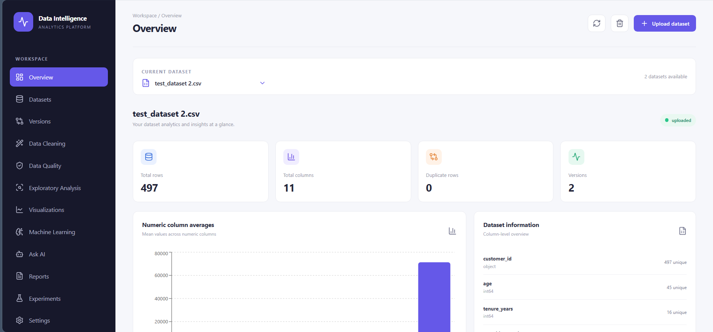

## Highlights

* **Grounded AI.** Gemini never calculates. It chooses from 10 validated, read-only analysis tools; pandas computes;
  a verifier checks every number in the answer against the computed results; the UI shows the evidence.
* **Safe data cleaning.** Recommendations, queue, before/after preview, apply as a **new version** (originals preserved, rollback anytime).
* **Real ML studio.** Regression, classification, clustering; leakage guards; baselines; CV; model registry, versioning,
  comparison, reproducibility, checksum-verified model loading, prediction forms.
* **Works without Gemini.** Core analysis, cleaning, charts, ML, reports run with no API key or internet.
* **Free and local.** PostgreSQL + filesystem + open-source Python; Gemini free tier optional.

## Features

| Module | Capabilities |
|---|---|
| Datasets | Upload (size/type validated), list, metadata + SHA-256, delete (files, models, reports too), CSV export, versions upload/compare/download/activate (from Stage 3-4) |
| Data cleaning | Missing values, duplicates, dtype correction, placeholder/invalid values, outliers (clip/remove/set-missing), text standardisation, name normalisation, scaling; recommendations; preview; audit history |
| EDA & quality | Numeric/categorical stats, missing and duplicate analysis, distributions, correlations, outliers, column insights, quality score |
| Visualisations | Histogram, distribution, bar (aggregated), line, scatter (+groups), box (grouped), correlation heat-map, missing values - computed from real values, interactive selectors |
| ML studio | 4 regressors, 3 classifiers, k-means (auto-k); train/test split, CV, feature selection, metrics + baselines, importance, confusion matrix, PCA cluster view, prediction UI |
| MLOps | Experiment tracker, model versions, config + environment + dataset fingerprint, artefact checksums, comparison, reproduce |
| Gemini | Dataset chat with persisted conversations, evidence view, explanations of dataset/quality/EDA/correlations/charts/models |
| Reports | 6-10 page PDF: dataset info, summary, quality, EDA, charts, models, optional Gemini sections, recommendations, limitations; CSV column profile |
| Operations | Structured logs, request IDs, `/health`, `/health/ready`, `/metrics`, `/ai/status`, Settings page |

## Technology stack

Python 3.12/3.13 - FastAPI - Pydantic - SQLAlchemy 2 - Alembic - PostgreSQL - pandas - NumPy - scikit-learn - joblib -
matplotlib + ReportLab (PDF) - `google-genai` (Gemini) - ydata-profiling (Stage 2 profile) - pytest -
React 19 - TypeScript - Vite 8 - Recharts - Axios - Lucide.

## Architecture

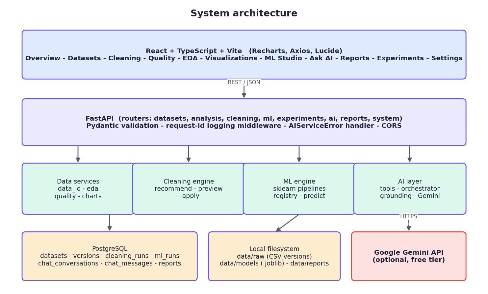

Details: [Architecture](docs/ARCHITECTURE.md) - [Database](docs/DATABASE.md) - [AI](docs/AI_ARCHITECTURE.md) -
[ML](docs/ML_ARCHITECTURE.md) - [Security](docs/SECURITY.md) - [API](docs/API.md) - [Testing](docs/TESTING.md) -
[Limitations](docs/LIMITATIONS.md) - [Troubleshooting](docs/TROUBLESHOOTING.md) - [Technical report](reports/Technical_Report.pdf).

## Project structure

```text
InsightForge/
├── data/                  samples/ (demo CSV); raw/, models/, reports/, profiles/ are generated and git-ignored
├── docs/                  documentation, diagrams, screenshots
├── frontend/              React + TypeScript app (src/pages, src/components, src/lib)
├── migrations/            Alembic (fresh DB and existing DB both reach head)
├── reports/               Technical_Report.md / .pdf
├── scripts/               smoke_test.py, generate_sample_data.py, generate_diagrams.py, generate_api_docs.py, build_technical_report.py
├── src/app/
│   ├── routes/            datasets, analysis, cleaning, ml, experiments, ai, reports, system
│   ├── schemas/           Pydantic models
│   ├── models/            SQLAlchemy tables
│   ├── services/          data_io, eda, quality, charts, cleaning, ml/, ai/, reporting/
│   ├── config.py  logging_config.py  metrics.py  database.py  main.py
├── tests/                 294 tests
├── .env.example  alembic.ini  requirements.txt  requirements-dev.txt
```

## Quick start (Windows PowerShell)

Full guide with every command: **[docs/WINDOWS_GUIDE.md](docs/WINDOWS_GUIDE.md)**.

```powershell
python -m venv .venv; .\.venv\Scripts\Activate.ps1
python -m pip install -r requirements-dev.txt
Copy-Item .env.example .env          # then edit DATABASE_URL (and optionally GEMINI_API_KEY)
psql -U postgres -c "CREATE DATABASE ai_data_platform;"
python -m alembic upgrade head
python -m uvicorn app.main:app --app-dir src --reload --port 8000
# second window
cd frontend; npm install; npm run dev        # http://localhost:5173
```

## Configuration

All settings are environment variables (see `.env.example`). Important ones:

| Variable | Default | Meaning |
|---|---|---|
| `DATABASE_URL` | required | PostgreSQL connection string |
| `GEMINI_API_KEY` | unset | Enables AI features. Free key: https://aistudio.google.com/apikey |
| `GEMINI_MODEL` | `gemini-3.5-flash-lite` | Any model your key can use |
| `AI_MAX_TOOL_CALLS` / `AI_REQUESTS_PER_MINUTE` | 6 / 20 | Quota and safety limits |
| `MAX_UPLOAD_MB` / `MAX_DATASET_ROWS` | 25 / 500000 | Upload limits |
| `ML_MAX_TRAIN_ROWS` / `ML_RANDOM_STATE` | 100000 / 42 | Training limits / default seed |

**Gemini cost note:** the free tier has rate and daily limits that Google may change; exceeding them returns HTTP 429, which the
app shows as a clear message. Paid usage can incur charges. Free-tier prompts may be used by Google to improve its products, so avoid
sensitive data. Only aggregates and short value samples (never the full dataset) are sent.

## Testing

```powershell
python -m pytest                       # 294 tests, no network, no API key
cd frontend; npm run lint; npm run build
python scripts\smoke_test.py --skip-ai # end-to-end against the running backend
```

## Report generation

UI: **Reports -> Generate PDF report**. API: `POST /datasets/{id}/reports` with `{"include_ai": true|false, "run_ids": [..]}` then
`GET /reports/{id}/download`. Files are written to `data/reports/`. The project's own technical report is in `reports/`.

## API

Interactive: http://127.0.0.1:8000/docs. Full table: [docs/API.md](docs/API.md) (52 operations, generated from OpenAPI).
Stage 1-4 endpoints and the `/` and `/health` payloads are unchanged.

## Screenshots

### 1. Overview and Datasets


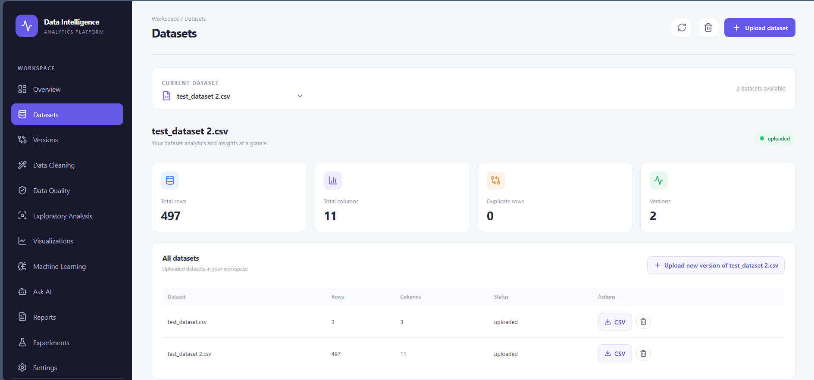

---

### 2. Data Cleaning and Quality

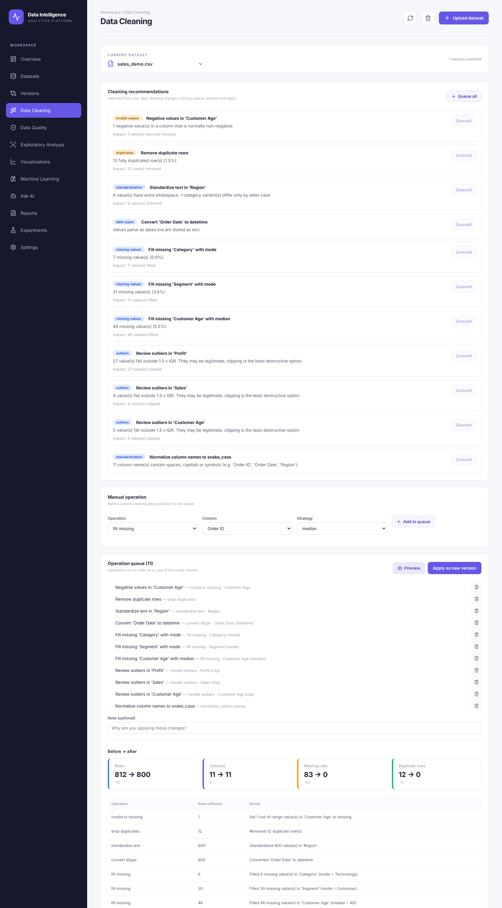

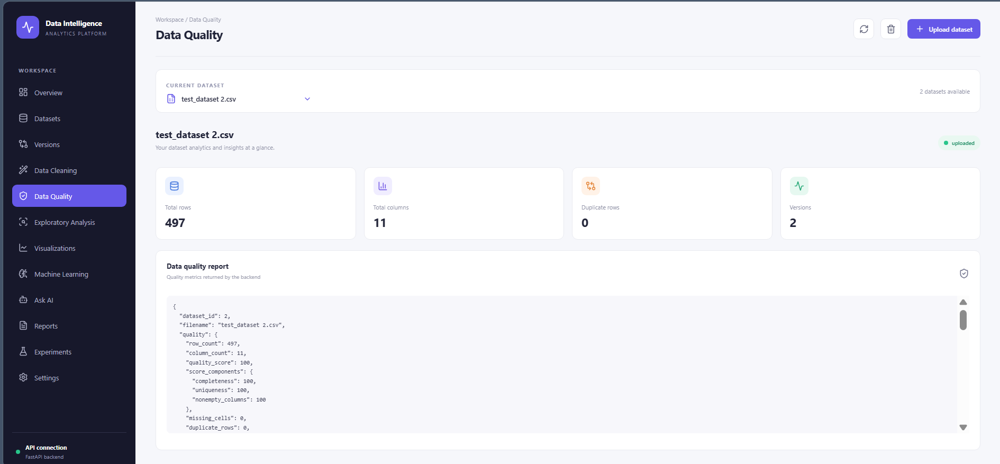

---

### 3. Exploratory Data Analysis and Visualizations

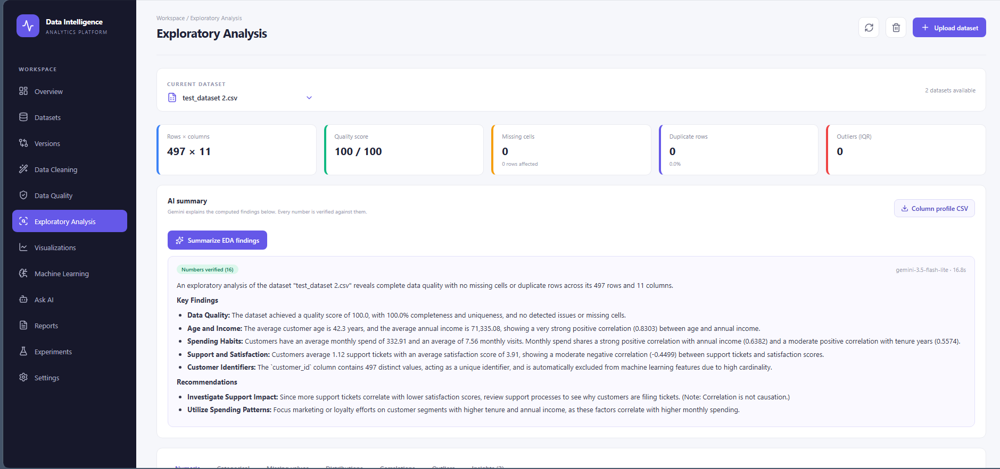

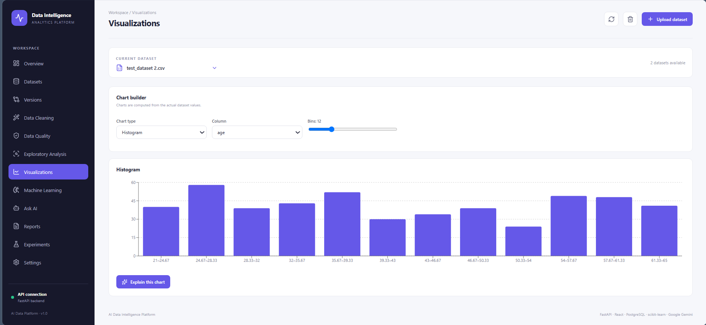

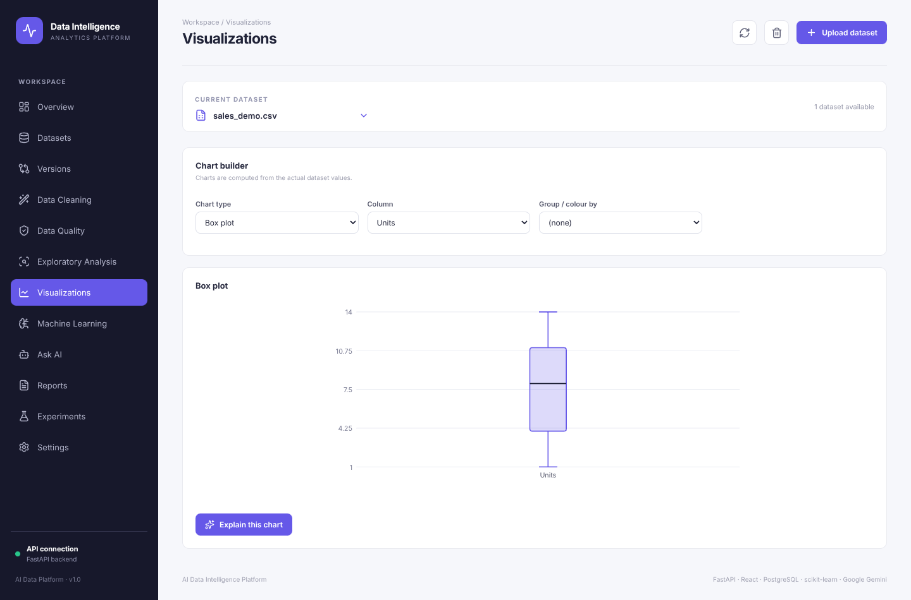

---

### 4. Machine Learning

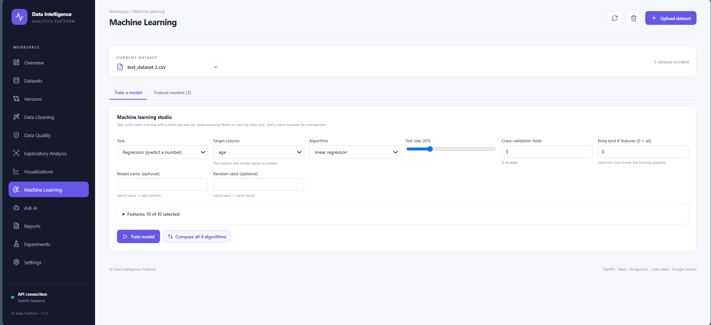

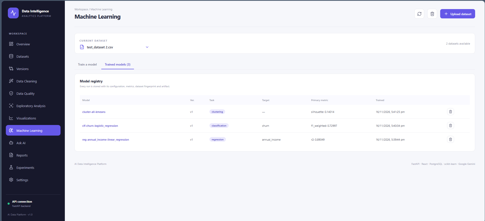

---

### 5. AI and Reports

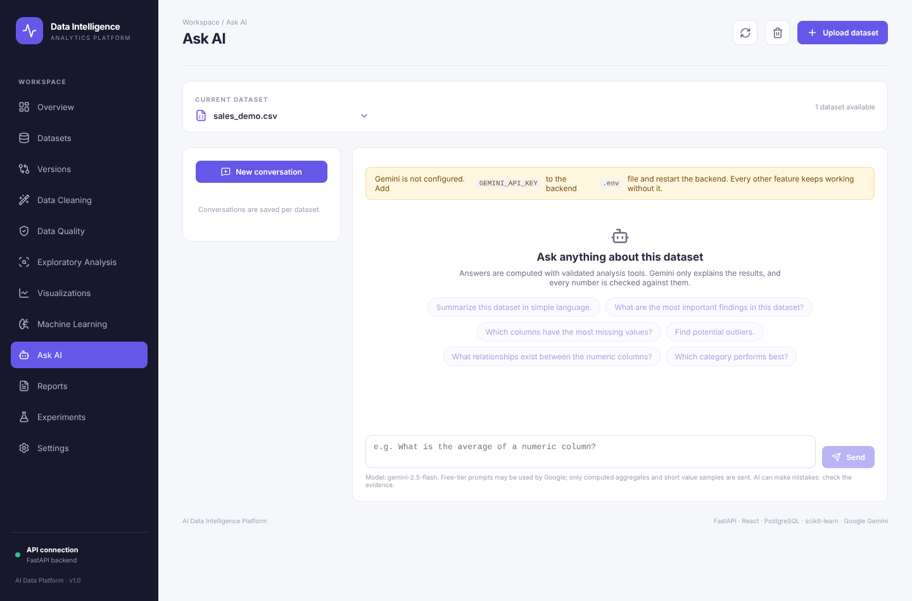

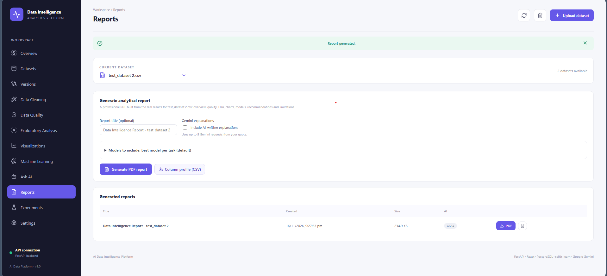

---

### 6. Experiments and Settings

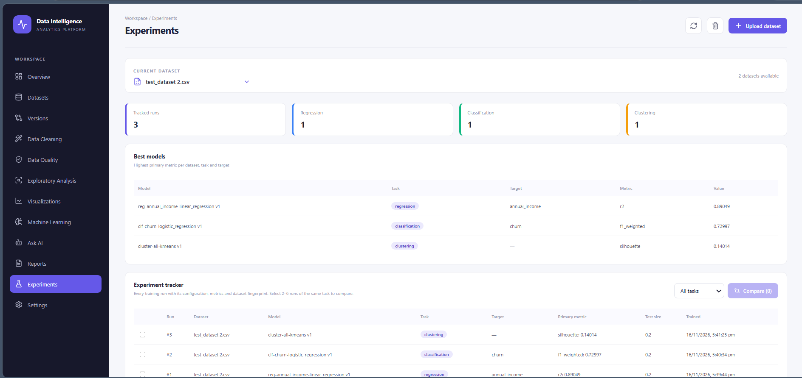

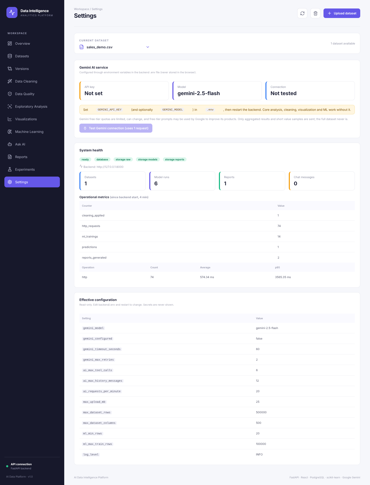

## Troubleshooting

See [docs/TROUBLESHOOTING.md](docs/TROUBLESHOOTING.md).

## Limitations

See [docs/LIMITATIONS.md](docs/LIMITATIONS.md). Notably: live Gemini calls were not exercised by the automated build, there is no
authentication, and training is synchronous.

## License

See `LICENSE`.


