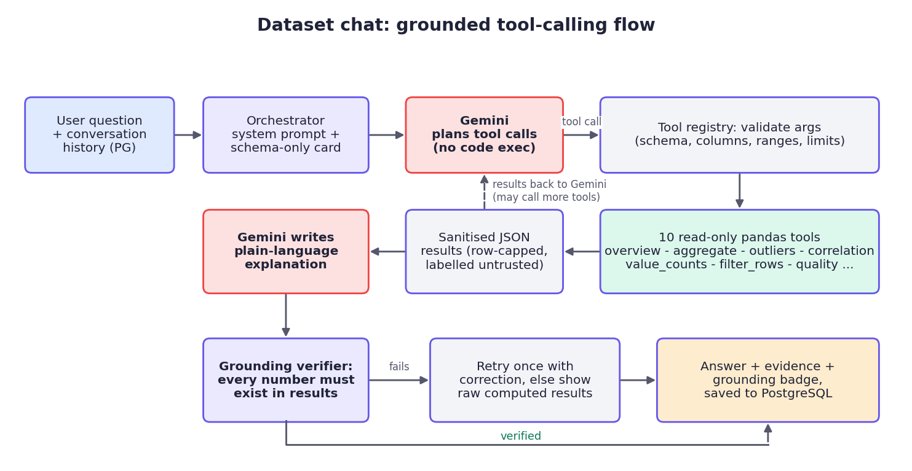

# AI architecture (Google Gemini)

## Principle: Gemini explains, code computes

A language model cannot be trusted with arithmetic over a dataset, and retrieval over embedded
rows cannot compute an average. Instead of classic RAG over rows, the platform uses
**grounded generation with tool calling**:

1. **Context ("retrieval")** - a schema-only card (column names, types, missing counts, row count).
   No raw rows and no statistics are placed in the prompt.
2. **Tools** - ten validated, read-only analytical functions (`services/ai/tools.py`):
   `get_dataset_overview`, `get_column_details`, `compute_aggregate` (mean/median/sum/min/max/std/count/nunique,
   filters, group-by, sort), `missing_values_report`, `find_outliers`, `analyze_correlation`, `value_counts`,
   `filter_rows`, `data_quality_summary`, `describe_distribution`.
3. **Guardrails** - argument validation, limits, sanitisation, grounding verification (below).

No vector database is used: the data is tabular, and semantic retrieval would add infrastructure
without improving accuracy. (If dataset *documentation* were added later, pgvector would be the right
tool for it.)

## Orchestration (`services/ai/orchestrator.py`)

* System prompt = non-negotiable rules + schema card, with the schema wrapped as untrusted labels.
* Loop: Gemini returns function calls -> each is validated and executed -> results go back as
  function responses. **Automatic function calling is disabled**; the application controls every step.
* Budget: at most `AI_MAX_TOOL_CALLS` (6) tool executions per question; afterwards tools are withdrawn
  and the model must answer from what it has. Row limit per tool result: `AI_MAX_TOOL_ROWS` (20).
* History: the last `AI_MAX_HISTORY_MESSAGES` (12) user/assistant texts are replayed. Tool results are
  *recomputed* each question, so answers always reflect the current dataset version.
* Provider details (`services/ai/llm.py`): official `google-genai` SDK; model from `GEMINI_MODEL`;
  temperature 0; request timeout; retries with exponential backoff + jitter for 429/5xx/timeouts only;
  classified errors (`not_configured`, `auth`, `quota`, `rate_limited`, `timeout`, `model_unavailable`,
  `blocked`, `bad_request`, `server`, `empty`, `busy`); the model's raw content is replayed verbatim
  between steps (needed for thought signatures).
* Protection of your quota and server: `AI_REQUESTS_PER_MINUTE` sliding window and
  `AI_MAX_CONCURRENT` simultaneous requests (`services/ai/guard.py`).

## Preventing invented statistics

| Layer | Mechanism |
|---|---|
| 1 | Prompt forbids numbers that are not in tool results and forbids mental arithmetic. |
| 2 | Only computed values reach the model; temperature 0. |
| 3 | Strict argument validation: unknown tools/arguments/columns are rejected with an explanatory error the model can recover from. |
| 4 | **Grounding verifier** (`grounding.py`): every number in the answer must match a number in the tool results (or in the user's question/history). Matching is precision-aware: "0.85" tolerates +-0.005, "52k" +-500 (max 1.5%), a rounded "52,000" at most 1% - "100" can never match 95. Percentages and abbreviations (k/M/B) are understood. |
| 5 | On failure the model gets one correction message; if it fails again the user is shown a clear notice plus the **raw computed results** instead of the unverified prose. |
| 6 | The UI shows a verification badge and an expandable **"How this was computed"** view of every tool call and result. |

The same verifier protects the explanation endpoint (`/datasets/{id}/ai/explain`) and the PDF report
(each AI section prints its verification status).

## Prompt-injection and untrusted data

CSV cells and column names are attacker-controlled. Defences:

* The model can only choose among whitelisted tools; there is **no code, SQL or shell execution** anywhere.
  Even a fully "hijacked" model can only ask for the same read-only analyses a user could.
* Tool arguments are schema-validated; columns must exist; values are range-checked; filter operators are an enum.
* Everything returned to the model passes `sanitize()`: control characters removed, whitespace collapsed,
  strings truncated to `AI_MAX_CELL_CHARS` (80), and the result is labelled
  `data_origin: untrusted_dataset_content`. The system prompt states that such content is data, never instructions.
* Raw rows are only exposed through `filter_rows` (max 20 rows, truncated cells) when the model needs them.
* Tested: dangerous tool names (`run_python`) are refused; injection strings arrive sanitised and labelled.

Honest limitation: prompt-injection defence is risk reduction, not proof. The strongest guarantee is
architectural (no write or execute capability) rather than the prompt wording.

## Explanations and reports

`services/ai/explain.py` builds a compact JSON of *facts* (EDA, quality, correlations, a model run, a chart)
from deterministic code and asks Gemini to explain only those facts, then runs the verifier. The PDF report
(`routes/reports.py`) can include up to five such explanations (insights, quality, up to three models);
if Gemini fails mid-way the report is still produced with a note.

## Quotas, cost and privacy

* The free tier is rate- and quota-limited and subject to change; limits differ by model. Check your own
  limits in Google AI Studio. A chat question uses ~2-4 requests (tool call(s) + final answer; +1 on a correction).
  Reports with AI use up to 5. `AI_REQUESTS_PER_MINUTE` defaults to 20 to protect the quota.
* Data sent to Google: column names, types, missing counts, **computed aggregates**, and up to 20 sample
  rows only when `filter_rows` is used. The full dataset is never uploaded. On Google's free tier,
  prompts may be used to improve Google's products - review Google's current terms before using sensitive data.
* Without a key the app stays fully usable; AI routes answer `503 not_configured` with setup instructions.

## Not verified live

Automated tests mock the SDK and the model; the author could not call the live API (no credentials in the
build environment). Use **Settings -> Test Gemini connection** or `python scripts/smoke_test.py` with your key
to verify end-to-end on your machine.
