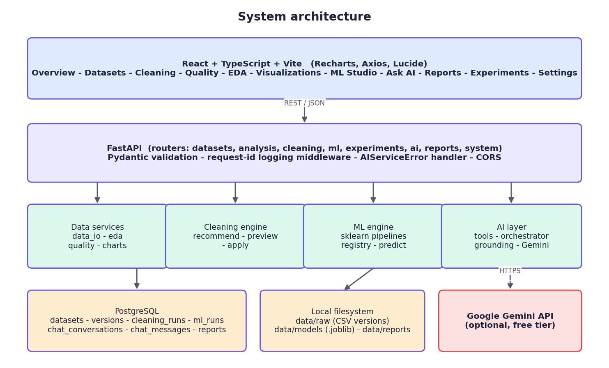
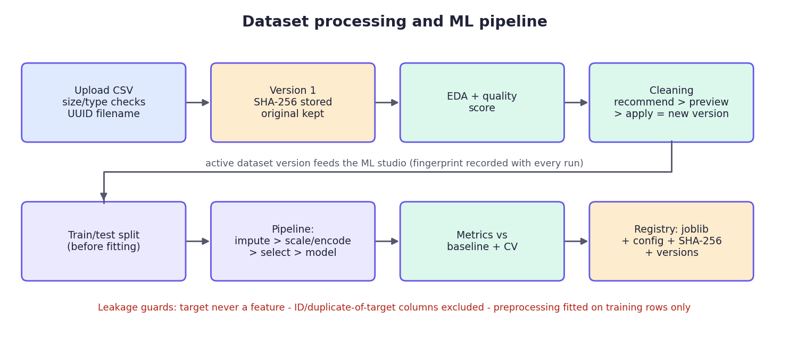

# Architecture

## Layers and responsibilities

| Layer | Location | Responsibility |
|---|---|---|
| UI | `frontend/src` | React 19 + TypeScript + Vite. `App.tsx` is the shell (navigation, dataset selector, legacy pages); `pages/*` are the feature pages; `components/*` shared UI, charts, AI widget; `lib/api.ts` Axios client + error mapping; `hooks.ts` data-loading hook. |
| API routes | `src/app/routes` | HTTP only: parse/validate, call services, map errors to status codes. One router per capability (`datasets`, `analysis`, `cleaning`, `ml`, `experiments`, `ai`, `reports`, `system`). |
| Schemas | `src/app/schemas` | Pydantic request models (e.g. the discriminated union of cleaning operations, `TrainRequest`). They are the first validation gate. |
| Services | `src/app/services` | All business logic, no HTTP: `data_io`, `eda`, `quality`, `charts`, `cleaning`, `ml/`, `ai/`, `reporting/`. Pure functions where possible so they are unit-testable. |
| Models | `src/app/models` | SQLAlchemy tables. |
| Config / ops | `config.py`, `logging_config.py`, `metrics.py` | Environment-driven settings, JSON logging, in-process metrics. |
| Migrations | `migrations/` | Alembic; fresh databases and existing ones both upgrade to head. |

## Request lifecycle

1. `request_logging` middleware assigns an `X-Request-ID`, times the request, updates counters and logs
   `method / route template / status / duration` (never bodies or dataset content).
2. The router validates input (Pydantic + query constraints), loads the dataset row and the CSV through
   `data_io.load_dataframe` (cached by path + mtime + size, row/column limits enforced).
3. Services compute results deterministically with pandas / NumPy / scikit-learn.
4. AI endpoints additionally receive an `LLMClient` through a FastAPI dependency
   (`services/ai/provider.get_llm`); tests override it with a scripted fake.
5. `AIServiceError` is translated centrally in `main.py` to a structured JSON error + `Retry-After`.

## Data and storage

* PostgreSQL stores metadata, versions, audit trails, ML runs, chats and reports (see [DATABASE.md](DATABASE.md)).
* The filesystem under `AIDP_DATA_DIR` (default `data/`) stores the large artefacts:
  `raw/` (every CSV version, UUID-named), `profiles/`, `models/<dataset_id>/*.joblib`, `reports/*.pdf`.
* Deleting a dataset removes its rows (DB `ON DELETE CASCADE`) *and* its files (versions, models,
  reports) - see `services/artifacts.py`.

## Dataset processing pipeline

Original uploads are immutable. Cleaning always works on a copy and writes a **new version**
(`DatasetVersion`) plus an audit row (`CleaningRun`). `dataset.file_path` points at the *active*
version; any version can be re-activated (rollback) without deleting anything. Every ML run records the
version number and SHA-256 of the data it used.

## Design decisions

* **Deterministic first, AI second.** All numbers come from pandas/scikit-learn code. Gemini only
  plans which tool to call and explains results (see [AI_ARCHITECTURE.md](AI_ARCHITECTURE.md)).
* **Core features never depend on Gemini.** If the key is missing or the quota is exhausted every
  non-AI feature still works; AI endpoints return a precise, actionable error.
* **Additive evolution.** Existing endpoints, schemas and the `/` and `/health` payloads are
  unchanged (the original 111 tests still pass unmodified).
* **No heavy infrastructure.** No Docker/Kubernetes/CI by project scope; MLflow was deliberately not
  added: a PostgreSQL-backed tracker plus joblib artefacts provide run tracking, versioning,
  comparison and reproducibility with zero extra services and no large dependency tree.
* **Lean dependencies.** New runtime packages: `google-genai`, `scikit-learn`, `joblib`, `reportlab`,
  `matplotlib` (already pulled by ydata-profiling), `httpx`.
